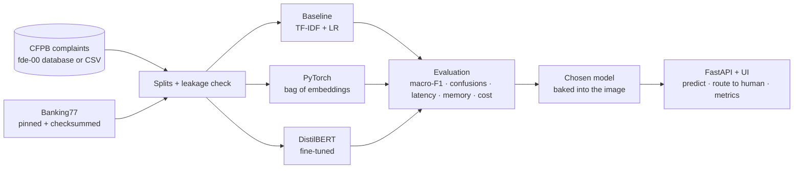

> **Learner starter.** This repo is generated from the reference solution.
> Work through `labs/` week by week and replace each `TODO` until `make exercises` is green
> (`make test` stays green throughout).
> Do not open the reference repo until you have tried each exercise yourself.

# fde-01-foundations: complaint-routing classifier

[](https://codespaces.new/sundayayandele/fde-01-foundations-starter?quickstart=1)

Phase 1 (weeks 5–10) of the **Forward Deployed ML Engineer: Zero-to-Hired** series. You build the system most ML engagements in a bank start with: read an incoming complaint or customer message, decide where it should go, and **send it to a person when the model is not sure**.

**The system:** a typed, tested Python package and CLI (`complaint-router`) that trains and compares three model families on the same splits:

1. **Baseline:** TF-IDF word and character n-grams + logistic regression (scikit-learn).
2. **From scratch:** a bag-of-embeddings neural network written in PyTorch, with its own vocabulary, training loop and early stopping.
3. **Transformer:** fine-tuned `distilbert-base-uncased` (Hugging Face).

The winner is served by a FastAPI service with a small web UI. Every prediction comes with a **routing decision** (auto-route or human review) based on confidence and margin, and Prometheus metrics that show when traffic drifts. It runs on Docker Desktop, Podman Desktop, Rancher Desktop, local Kubernetes, OpenShift, AWS, Azure and GCP.

Datasets: the CFPB complaints stored by [`fde-00-programming`](https://github.com/sundayayandele/fde-00-programming) (predict `product` or `issue` from the narrative) and **Banking77** (77 banking intents, CC BY 4.0), which is the public benchmark the results below are measured on.



## Quick start

```bash
python3.12 -m venv .venv && source .venv/bin/activate
make install                 # CPU-only PyTorch + package
make download                # Banking77 from GitHub, pinned commit, SHA-256 checked
make train                   # baseline (~25 s) and PyTorch model (~40 s) on a laptop CPU
make evaluate && make compare
make run                     # UI on http://127.0.0.1:8000/  ·  API docs on /docs
```

Your own complaints: `make train DATASET=cfpb-db:sqlite:///../fde-00-programming/artifacts/complaints.db` (target `product` by default; add `--target issue` with the CLI), or `DATASET=cfpb-csv:data/complaints.csv`.

## Results

Measured with `make train`, `make evaluate`, `make compare` and `make probe-transformer` on the date shown (UTC). Raw reports are in [`evals/results/`](evals/results/).

> TODO week-10 results table: complete this section (see labs/).

## Run it everywhere

| Path | Command | What runs |
| --- | --- | --- |
| Local Python | `make install && make e2e` | Trains a fixture model, starts the API, runs the smoke checks |
| Docker Desktop | `make up-docker` | Image with Banking77 models baked in (trained during `docker build`) |
| Podman Desktop | `make up-podman` | Same image as a pod (`podman kube play`) |
| Rancher Desktop | `make up-rancher` | Same image on Rancher's moby engine |
| Local Kubernetes | `make k8s-docker`, `make k8s-rancher`, `make k8s-kind` | Deployment, HPA, PDB, NetworkPolicy (egress limited to DNS) |
| OpenShift | `oc apply -k deploy/openshift` | Route with edge TLS, arbitrary UID |
| Helm | `helm install router deploy/helm/fde-01-foundations` | Same posture as the Kustomize base |
| AWS / Azure / GCP | `make tf-aws-plan` (and `azure`, `gcp`) | Fargate, Container Apps, Cloud Run; no secrets needed |

Offline image build: `docker build --build-arg TRAIN_DATASET=fixture -t fde-01-foundations:local .`. Include DistilBERT: `--build-arg TRAIN_TRANSFORMER=true` (slow). Step by step: [desktop labs](docs/learning/DESKTOP-LABS.md), [cloud labs](docs/learning/CLOUD-LABS.md), [deployment](docs/DEPLOYMENT.md).

## API

| Endpoint | Returns |
| --- | --- |
| `GET /` | Web UI: type a message, see the label, confidence, top 3 and the routing decision |
| `POST /api/v1/predict` `{text, model?}` | `label`, `confidence`, `route` (`auto` or `human`), `reason`, `top`, `latency_ms` |
| `POST /api/v1/predict/batch` `{texts[], model?}` | Up to 256 decisions and the auto-routed count |
| `GET /api/v1/models` | Available bundles with dataset version and test metrics |
| `GET /health/live`, `GET /health/ready` | Liveness; readiness reports how many models are available |
| `GET /metrics/` | Requests, latency, `predictions_total{model,route}`, `prediction_confidence`, `model_inference_seconds` |

The service never logs or stores the text it is sent.

## Learning path

| Week | Lab | You build |
| --- | --- | --- |
| 5 | [Data, splits and leakage](labs/week-05-data-and-splits/README.md) | `stratified_split`, `find_leakage` |
| 6 | [A strong baseline](labs/week-06-baseline/README.md) | `build_pipeline` (TF-IDF + logistic regression) |
| 7 | [Evaluation that tells the truth](labs/week-07-evaluation/README.md) | `macro_f1` from scratch, `top_confusions` |
| 8 | [PyTorch from scratch](labs/week-08-pytorch-from-scratch/README.md) | `Vocab.build`, `Vocab.encode`, `BagOfEmbeddings.forward` |
| 9 | [The training loop](labs/week-09-training-loop/README.md) | `train_epoch`, early stopping, a transformer run |
| 10 | [Serve, route and decide](labs/week-10-serve-route-decide/README.md) | `route`, the results table, the ADR on which model ships |

**Phase 1 exit check:** from a fresh clone, `make test`, `make exercises` and `make e2e` pass; the three model families are compared on the same test set with macro-F1, latency, memory and cost; the chosen model runs in a container on one desktop engine; and an ADR explains the choice with your numbers.

## Repository map

```text
app/main.py, app/static/   API and web UI
src/complaint_router/      data, text, models/{baseline,neural,transformer}, metrics, routing,
                           registry, bench, evaluate, cli
tests/                     unit, model, API and CLI tests; fixtures/; e2e/smoke.yaml
scripts/                   transformer_serving_probe, smoke_test, make_starter, check_structure
evals/results/             committed evaluation reports behind the results table
labs/                      weeks 5–10
docs/                      architecture, ADRs, customer brief, model card, evaluation, datasets, security, cost
deploy/                    compose, podman, kubernetes, openshift, helm
terraform/                 aws, azure, gcp
monitoring/                Prometheus, alerts (human-review share, inference latency), Grafana
```

## Reference and starter

[`fde-01-foundations`](https://github.com/sundayayandele/fde-01-foundations) is the **reference** repo: complete code and measured results. [`fde-01-foundations-starter`](https://github.com/sundayayandele/fde-01-foundations-starter) is generated from it with `make starter` for learners. Each exercise becomes a `NotImplementedError("TODO ...")` stub, exercise tests are marked `@pytest.mark.exercise` (run them with `make exercises`), and the results table is blank for your own numbers.

## Licence

Code: [MIT](LICENSE). Written content: [CC BY-SA 4.0](LICENSE-CONTENT.md). Banking77: CC BY 4.0, © PolyAI (Casanueva et al., 2020). CFPB complaint data: US government open data. See [DATASETS](docs/datasets/DATASETS.md).

Part of [fde-zero-to-hired](https://github.com/sundayayandele/fde-zero-to-hired) by Sunday Ayandele.
