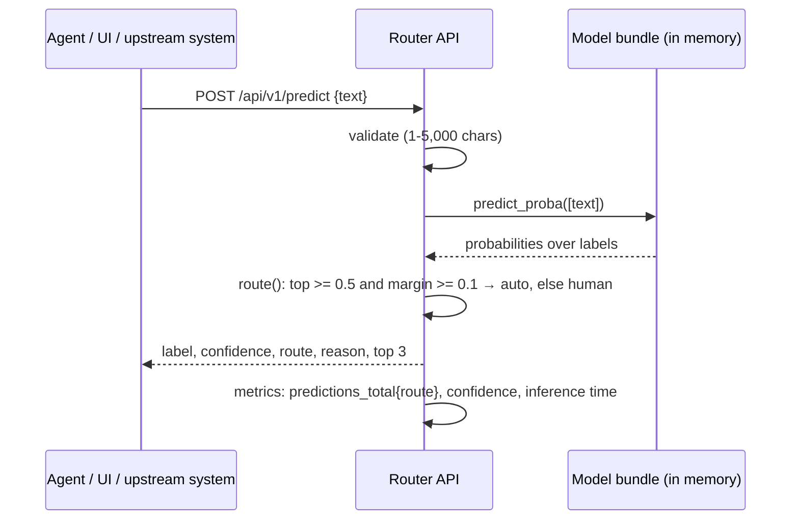

# Architecture

## Purpose

Route each incoming complaint or customer message to the right queue, automatically when the model is confident and to a person when it is not. Phase 1 proves the full loop on public data: data, three model families, honest evaluation, a decision, and a service that runs anywhere.

## Components

| Component | Code | Responsibility |
| --- | --- | --- |
| Data | `data.py` | Loaders (Banking77 pinned and checksummed, CFPB CSV, fde-00 database, fixture), stratified splits, leakage removal |
| Text | `text.py` | One normalisation for training and serving: lower case, CFPB redactions → `<redacted>`, amounts → `<amount>`, digits → `0` |
| Models | `models/baseline.py`, `models/neural.py`, `models/transformer.py` | Same `Classifier` interface: `fit`, `predict_proba`, `save`, `load` |
| Metrics | `metrics.py` | Macro-F1 (from scratch), per-class report, confusion matrix, top confusions |
| Routing | `routing.py` | Probability → label + `auto`/`human` decision with a reason |
| Registry | `registry.py` | Bundles on disk: `models/<dataset>/<kind>/` + `meta.json` (data version, splits, params, metrics) |
| Bench and evaluation | `bench.py`, `evaluate.py` | Latency p50/p95, CPU-seconds per 1,000, memory (framework vs model), size; JSON and Markdown reports |
| CLI | `cli.py` | `download`, `train`, `evaluate`, `compare`, `predict`, `list` |
| API and UI | `app/main.py`, `app/static/index.html` | Predict, batch, models, health, metrics; no text logged |

## Request flow

## Training flow

`make download` → `make train` (baseline, MLP; optional transformer) → `make evaluate` (full report per bundle) → `make compare` → decision recorded in an ADR → `docker build` re-trains the chosen models reproducibly inside the image (same pinned data, same seed).

## Design choices

| Decision | Record |
| --- | --- |
| Evaluation protocol: pinned data, stratified validation split, leakage removal, macro-F1 | [ADR-004](../adr/ADR-004-evaluation-protocol.md) |
| Models baked into the image; readiness does not require a model | [ADR-005](../adr/ADR-005-models-baked-into-the-image.md) |
| Which model ships | [ADR-006](../adr/ADR-006-which-model-ships.md) |
| Confidence-and-margin routing to a human | [ADR-007](../adr/ADR-007-route-to-human-when-unsure.md) |
| Same deployment matrix as every series repo | [ADR-003](../adr/ADR-003-deployment-matrix.md) |

## Limits

- Probabilities are not calibrated. The baseline's are usable for routing (96% accuracy when auto-routed on Banking77); the MLP's are over-confident. Calibration is a week-10 stretch task.
- One model per request; no ensembles.
- No feedback loop yet: corrections made by human reviewers are not captured. `fde-03` adds evaluation sets built from them.
