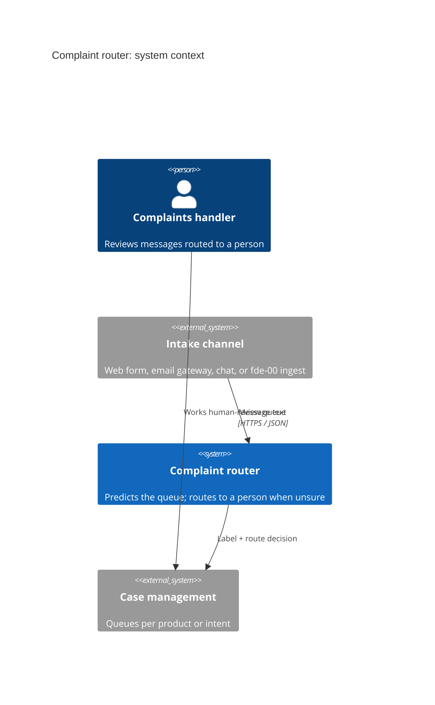
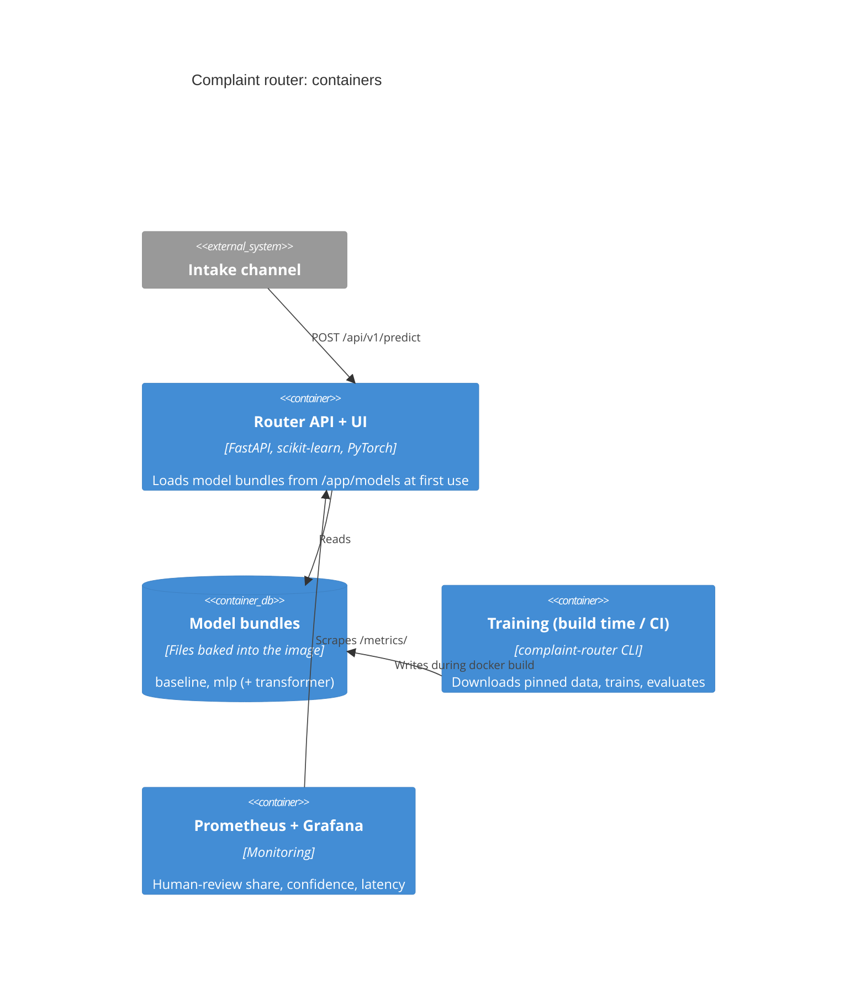

# C4 views

## Level 1: System context

## Level 2: Containers

## Level 3: Components

| Component | Module |
| --- | --- |
| HTTP layer, validation, metrics | `app/main.py` |
| Routing decision | `routing.py` |
| Bundle registry | `registry.py` |
| Models | `models/*.py` |
| Shared text normalisation | `text.py` |

Diagram sources: [`diagrams/source/`](../../diagrams/source/).
